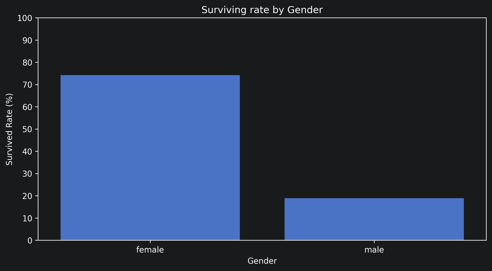
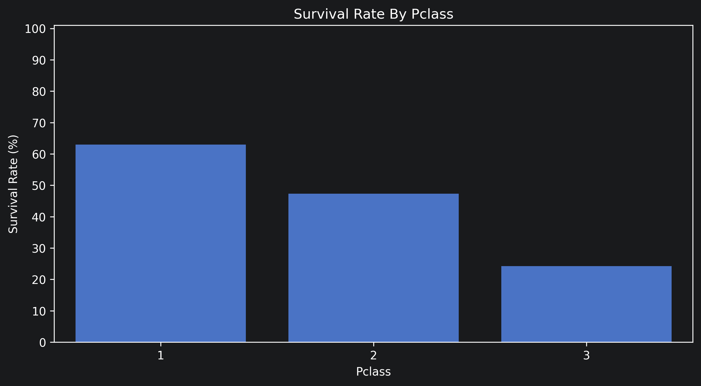
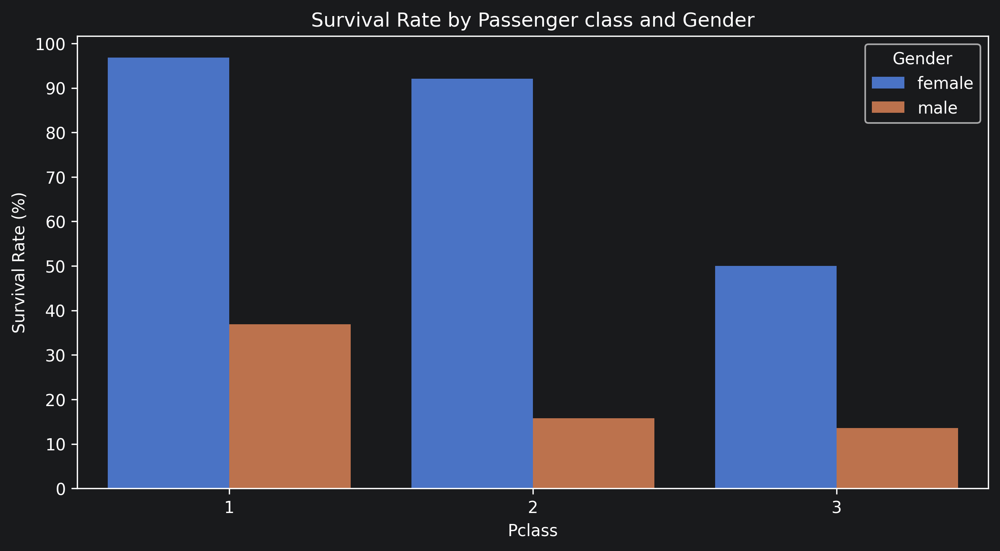
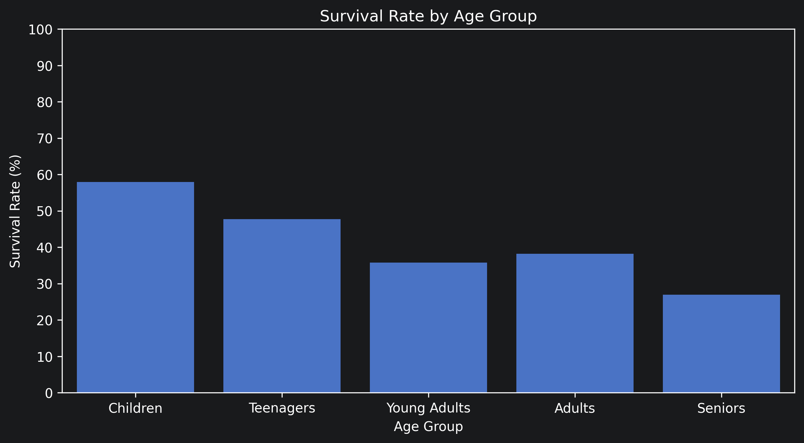
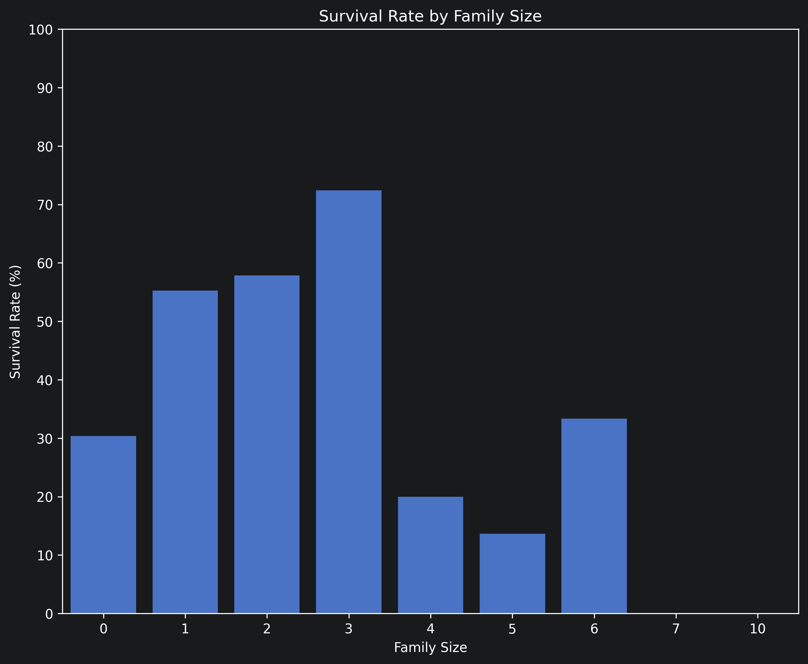
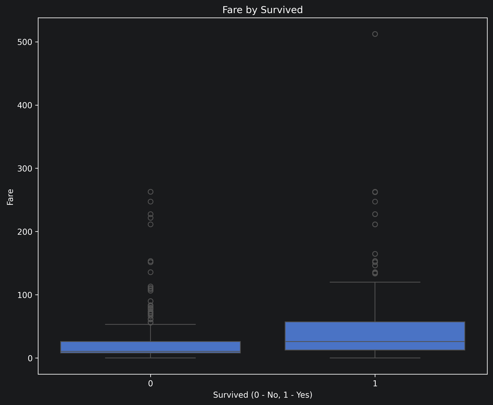
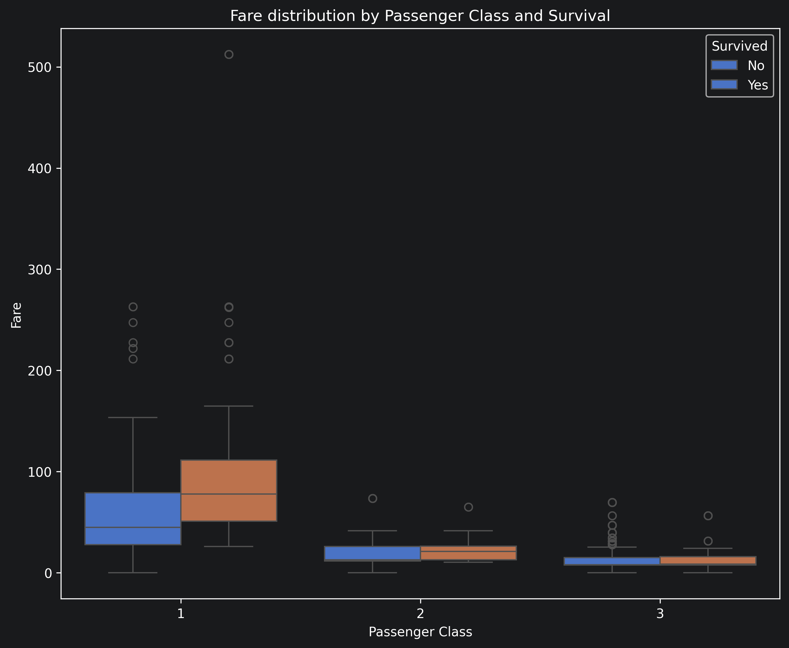
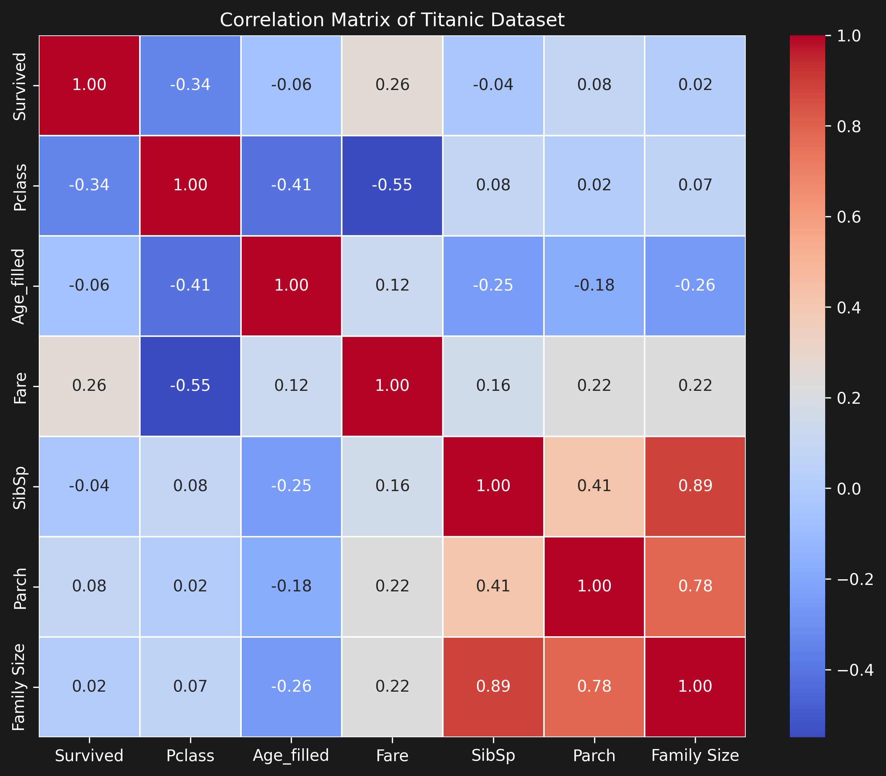

# Titanic Dataset — Exploratory Data Analysis

## Project Overview

This project focuses on exploratory data analysis (EDA) of the Titanic passenger dataset.

The main goal is to investigate passenger characteristics and identify patterns associated with survival. The analysis explores relationships between survival rates and features such as gender, passenger class, age, ticket fare, family size, and port of embarkation.

## Dataset

The dataset contains information about 891 Titanic passengers and includes 12 original features.

Key features include:

- `Survived` — whether the passenger survived (0 = No, 1 = Yes).
- `Pclass` — passenger class (1st, 2nd, or 3rd).
- `Sex` — passenger gender.
- `Age` — passenger age.
- `SibSp` — number of siblings or spouses aboard.
- `Parch` — number of parents or children aboard.
- `Fare` — ticket fare.
- `Embarked` — port of embarkation.

The dataset was obtained from the [Kaggle Titanic Competition](https://www.kaggle.com/competitions/titanic/data).

## Data Cleaning and Preparation

The following data preparation steps were performed:

- Inspected the dataset structure, data types, and missing values.
- Analyzed missing values in `Age`, `Cabin`, and `Embarked`.
- Filled missing `Age` values using median ages grouped by `Sex` and `Pclass`.
- Created an `Age_Group` feature to categorize passengers by age.
- Created a `FamilySize` feature using `SibSp` and `Parch`.
- Created a `TravelAlone` feature to distinguish passengers traveling alone from those traveling with family.
- Preserved the original `Age` column for comparison with the imputed values.

## Exploratory Data Analysis

The following analyses were performed to investigate factors associated with passenger survival:

### 1. Survival Analysis by Gender

Compared survival rates between male and female passengers.

**Key finding:** Female passengers had a significantly higher survival rate (74.2%) than male passengers (18.9%).

### 2. Survival Analysis by Passenger Class

Examined survival rates across the three passenger classes.

**Key finding:** Passengers in 1st class had the highest survival rate (approximately 63%), while passengers in 3rd class had the lowest (approximately 25%).

### 3. Survival Analysis by Age Group

Investigated survival rates across different age categories.

**Key finding:** Children had the highest survival rate (58%), while seniors had the lowest (approximately 27%).

### 4. Survival Analysis by Family Size

Analyzed how the number of family members aboard was associated with survival.

**Key finding:** Passengers traveling in small families (2–4 members) generally had higher survival rates than passengers traveling alone or in larger families.

### 5. Fare Analysis

Compared ticket fare distributions between survivors and non-survivors.

**Key finding:** Survivors generally paid higher fares. The median fare among survivors was 26, compared to 10.5 among non-survivors.

### 6. Survival Analysis by Port of Embarkation

Compared survival rates among passengers who embarked at different ports.

**Key finding:** Passengers embarking at Cherbourg (C) had the highest survival rate (55.4%), while Southampton (S) had the lowest (33.7%).

### 7. Correlation Analysis

Created a correlation matrix to examine relationships between numerical features.

**Key finding:** Passenger class had the strongest linear correlation with survival among the analyzed numerical features (-0.338), followed by ticket fare (0.257).

## Visualizations

### Survival Rate by Gender

### Survival Rate by Passenger Class

### Survival Rate by Gender and Passenger Class

### Survival Rate by Age Group

### Survival Rate by Family Size

### Fare Distribution by Survival

### Fare Distribution by Passenger Class and Survival

### Correlation Matrix

## Key Findings

The exploratory data analysis revealed several patterns associated with passenger survival:

1. **Gender:** Female passengers had a much higher survival rate than male passengers.
2. **Passenger Class:** Passengers in higher classes generally had better survival outcomes.
3. **Age:** Children had higher survival rates than most other age groups.
4. **Family Size:** Passengers traveling in small families showed relatively high survival rates.
5. **Ticket Fare:** Survivors generally paid higher ticket fares.
6. **Port of Embarkation:** Passengers embarking at Cherbourg had the highest observed survival rate.

Overall, gender and passenger class showed particularly strong differences in survival rates. Other features also revealed interesting patterns, although their relationships with survival were more complex.

These findings describe associations in the dataset and do not establish causal relationships.

## Technologies Used

- **Python** — main programming language.
- **Pandas** — data manipulation and analysis.
- **NumPy** — numerical operations.
- **Matplotlib** — data visualization.
- **Seaborn** — statistical data visualization.
- **Jupyter Notebook** — interactive analysis environment.